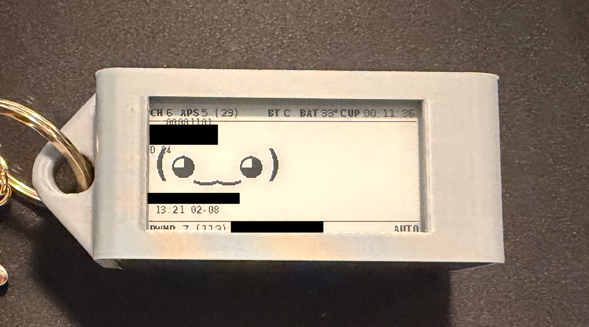

# Pwnagotchi Build

A hardware Pwnagotchi build for hands-on wireless security research and learning. **Educational purposes only.**

## Software

- [jayofelony/pwnagotchi](https://github.com/jayofelony/pwnagotchi/wiki) — the active community fork used for this build
- WPA2 configuration/troubleshooting via [pwnstore.org](https://pwnstore.org/pwnconfig.html)

## Hardware

| Component | Details |
|---|---|
| Board | Raspberry Pi Zero 2 WH — 4× 1 GHz, 512 MB RAM, WLAN, BT |
| Battery | PiSugar 3, 1200 mAh |
| Display | Waveshare 2.13" 250×122 ePaper HAT |
| Storage | Samsung EVO Plus (2024) microSD, 128 GB, 160 MB/s |
| Case | 3D-printed, design by [MAXDARKDOG](https://cults3d.com/en/users/maxdarkdog/3d-models) (v3, Waveshare + PiSugar3 variant) |

## Case files

The case `.stl` files are a third-party design by **MAXDARKDOG**, distributed on Cults3D — not included in this repo out of respect for the designer's license. Download them directly from [MAXDARKDOG's Cults3D profile](https://cults3d.com/en/users/maxdarkdog/3d-models) or the community-maintained [Pwnagotchi 3D printable cases list](https://pwnagotchi.org/3d-printable-cases/index.html), which links the same design.

## Notes

See [build-notes.txt](build-notes.txt) for the original setup notes.
